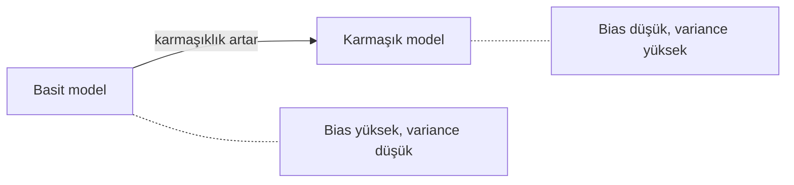

Bir modelin yeni verideki hatası üç parçadan oluşur:

$$
\text{Hata} = \text{Bias}^2 + \text{Variance} + \text{Gürültü}
$$

- **Bias (yanlılık):** Model çok basit, gerçek ilişkiyi yakalayamıyor. → *Underfitting*
- **Variance (varyans):** Model çok hassas; eğitim verisi biraz değişince tahminleri çok değişiyor. → [[Overfitting]]
- **Gürültü:** Verinin kendisindeki rastgelelik. Hiçbir model bunu azaltamaz.

> [!example] Dart tahtası benzetmesi
> - **Yüksek bias:** Atışlar birbirine yakın ama hedefin hep solunda.
> - **Yüksek variance:** Atışlar ortalamada hedefte ama tahtanın her yerine dağılmış.
> - **İkisi de düşük:** Hepsi hedefin ortasında. Amaç bu.

## Tradeoff (denge)

Model karmaşıklaştıkça **bias düşer, variance artar**. En iyi model, toplam hatanın en düşük olduğu ortadaki noktadır.

| Model | Bias | Variance |
| --- | --- | --- |
| Lineer regresyon (az feature) | Yüksek | Düşük |
| Derinliği sınırsız karar ağacı | Düşük | Yüksek |
| Random Forest | Düşük | Orta (ağaçların ortalaması variance'ı düşürür) |

## Doğru noktayı nasıl buluruz?

Farklı karmaşıklıktaki modelleri [[Cross-Validation]] ile karşılaştırıp validation hatası en düşük olanı seçeriz.
