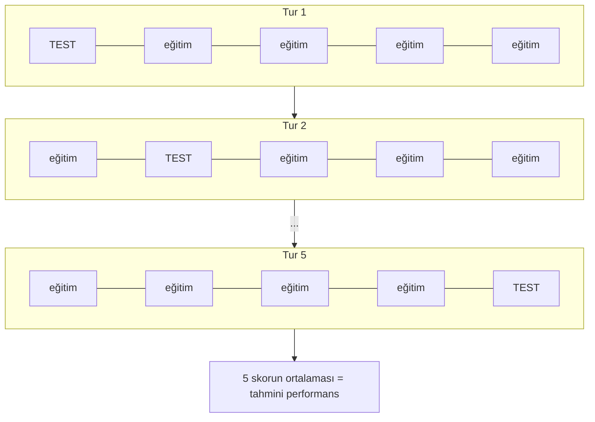

**Cross-validation:** Veriyi parçalara bölüp modeli **her seferinde farklı bir parçada test ederek** gerçek performansını tahmin etme yöntemi.

Neden gerekli? Tek bir train/test ayrımı şansa bağlıdır: test kısmı tesadüfen kolay gelirse modeli olduğundan iyi sanırız.

## K-Fold (en yaygın yöntem)

Veri **k** parçaya (fold) bölünür. Her turda 1 parça test, kalan k−1 parça eğitim için kullanılır. Örnek: k = 5



$$
\text{CV skoru} = \frac{1}{k} \sum_{i=1}^{k} \text{skor}_i
$$

## Kod (scikit-learn)

```python
from sklearn.datasets import load_iris
from sklearn.ensemble import RandomForestClassifier
from sklearn.model_selection import cross_val_score

X, y = load_iris(return_X_y=True)
model = RandomForestClassifier(random_state=42)

scores = cross_val_score(model, X, y, cv=5)  # 5-fold
print(scores.mean(), scores.std())
```

- `cv=5`: 5 fold
- `scores.mean()`: tahmini performans
- `scores.std()`: skorlar ne kadar dağınık? Yüksekse model kararsız, yani variance yüksek ([[Bias-Variance Tradeoff]])

## Dikkat edilecekler

> [!warning] Data leakage
> Scaling gibi ön işlemleri **CV'den önce tüm veriye** uygularsan test bilgisi eğitime sızar. Standart çözüm: ön işlemi bir `Pipeline` içine koyup `cross_val_score`'a pipeline'ı vermek.

- **Sınıflar dengesizse:** `StratifiedKFold` (her fold'da sınıf oranları korunur)
- **Zaman serisi:** `TimeSeriesSplit` (gelecekteki veriyle geçmiş tahmin edilmez)
- **Son test seti ayrı kalır:** CV model seçimi içindir; final skoru hiç dokunulmamış bir test setinde ölçülür.

CV, [[Overfitting]]'i yakalamanın standart yoludur: eğitim skoru yüksek, CV skoru düşükse model ezberliyordur.
