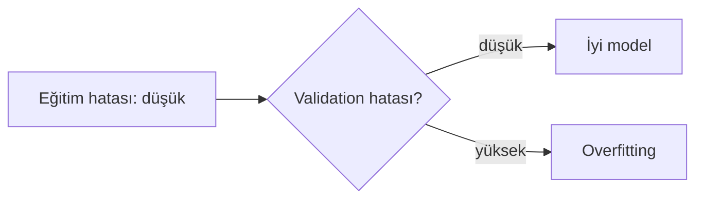

**Overfitting (aşırı öğrenme):** Model, eğitim verisindeki genel kalıbı değil, **gürültüyü de ezberler**. Eğitimde çok iyi, yeni veride kötü sonuç verir.

> [!example] Günlük hayattan örnek
> Sınava, soruları anlamadan **cevap anahtarını ezberleyerek** çalışan öğrenci. Aynı sorular gelirse 100 alır, soru biraz değişirse kalır.

## Nasıl anlaşılır?

| Durum | Eğitim hatası | Validation hatası |
| --- | --- | --- |
| Underfitting | Yüksek | Yüksek |
| İyi model | Düşük | Düşük |
| Overfitting | **Çok düşük** | **Yüksek** |

Validation hatasını güvenilir ölçmenin standart yolu: [[Cross-Validation]].

## Nedenleri

- Model veriye göre **çok karmaşık** (örneğin çok derin bir karar ağacı)
- **Az veri**
- Çok fazla feature

## Çözümler

- Daha fazla veri
- **Regularization** (L1/L2): büyük ağırlıkları cezalandırır
- Daha basit model (örneğin ağacın derinliğini sınırlamak)
- **Early stopping**: validation hatası artmaya başlayınca eğitimi durdurmak

Overfitting, [[Bias-Variance Tradeoff]] içindeki **yüksek variance** durumudur.
