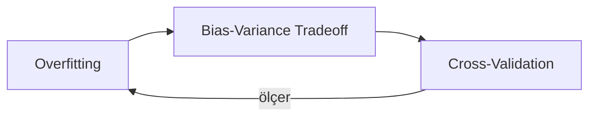

Merhaba! Burası öğrendiklerimi not aldığım **dijital bahçem**. Notlar birbirine bağlı; sağ alttaki **graph** ile aralarındaki ilişkiyi görebilirsin.

## Data Science

- [[Overfitting]]: Model eğitim verisini ezberlerse ne olur?
- [[Bias-Variance Tradeoff]]: Hata nereden gelir?
- [[Cross-Validation]]: Modelin gerçek performansını nasıl ölçeriz?

